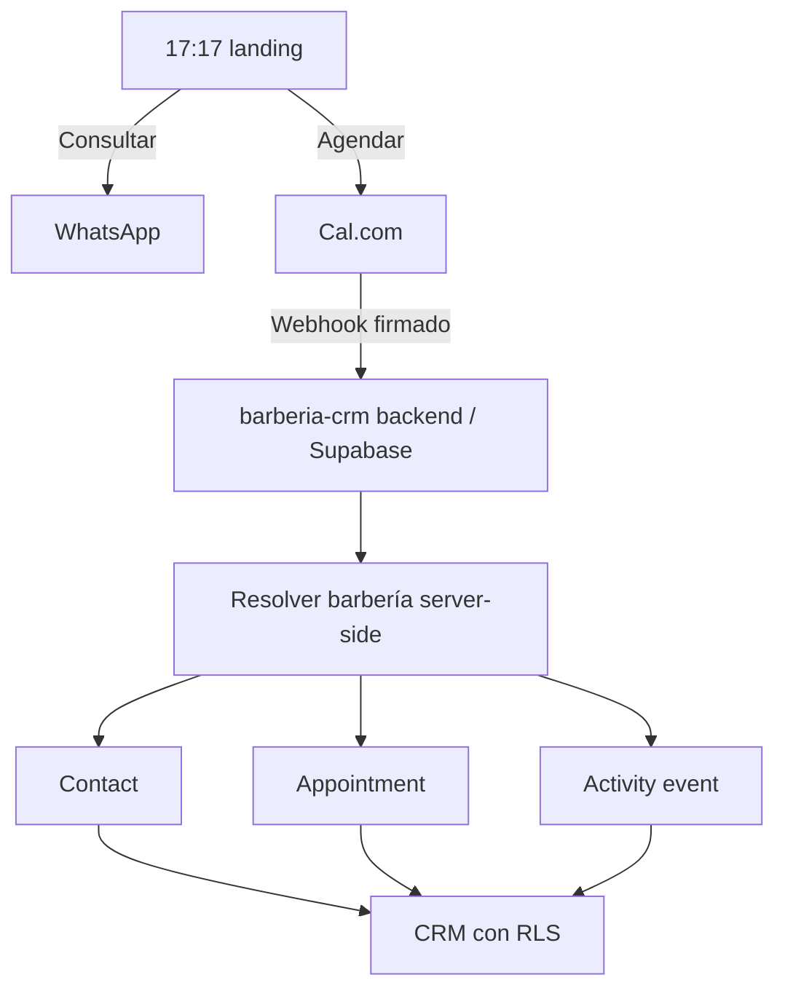

# Contrato de integración 17:17 → barberia-crm

Estado: preparación de landing, 2026-10-12. Este contrato propone el backend futuro; no crea CRM, tablas, proyecto Supabase, webhooks ni credenciales. Revisar nuevamente las APIs oficiales al implementarlo.

## Flujo y responsabilidades

La landing navega a Cal.com. No confirma reservas mediante callbacks, redirect, localStorage ni una petición manual al CRM. Cal.com es la fuente autoritativa de reservas. Un clic de agenda tampoco equivale a una reserva.

## Configuración pública de esta landing

Extender `business` en `src/data.mjs`, que ya centralizaba marca, contactos, ubicación, horarios y redes. `business.slug = "1717"` es el identificador editorial público; `business.booking.provider = "cal.com"`; `business.booking.url` contiene el enlace entregado:

https://cal.com/ezequiel-oviedo-dthlhd/barberia

Actualización 2026-10-12: `bookingLink()` lleva a `/reservar`. `serviceBookingLink()` resuelve exclusivamente el evento verificado de ese servicio; valida HTTPS, Cal.com, duración, presencial y Round Robin. Sin evento verificado, coordina por WhatsApp contextual. Rulos siempre exige consulta previa. El enlace genérico se conserva como referencia histórica y no se usa como fallback. No se descarga un calendario embebido. Duraciones confirmadas y configuración externa: [BOOKING_SETUP.md](BOOKING_SETUP.md).

QA anterior del enlace real: responde 200 y presenta horarios en 390/1440px; título `Barberia | Jonatan Ramos | Cal.com`, **40m / Cal Video**. El dueño aclaró que **40 minutos sí es correcto para corte**; rulos y tinte necesitan eventos de 120 minutos, lavado de 10 y otros servicios cortos bloques de 40. Cal Video es una ubicación de videollamada que debe cambiarse a presencial. Asignación automática solicitada; falta configurar equipo, calendarios y horarios de ambos. El acceso a la cuenta fue denegado en el navegador, no se aplicaron cambios externos.

Publicable: slug, booking URL, WhatsApp, branding, ubicación, horarios, Instagram, Maps. Si se habilita un formulario futuro, también endpoint público y token específico del formulario. Hoy no hay formulario ni token.

Prohibido: UUID de `barberia_id`, service role, API keys privadas de Cal.com, webhook secret, credenciales DB. Ninguno forma parte del HTML, JS, query string, almacenamiento del navegador o variables públicas. El slug no concede acceso ni decide un tenant confiable.

## Modelo de workspace futuro

Workspace ≈ barbería. Una aplicación y una base compartidas, con objetos, vistas y permisos consistentes. Una barbería nueva añade configuración, usuarios, servicios, barberos, integración y origen permitido; no añade otro CRM/backend/base. Inspiración conceptual de Twenty, sin motor de metadata ni custom objects dinámicos.

Modelo propuesto:

| Entidad | Alcance |
| --- | --- |
| `barberias` | Workspace y slug único |
| `profiles` | Identidad vinculada a Supabase Auth |
| `barberia_memberships` | Usuario, barbería, rol y estado; permite múltiples workspaces |
| `barbers`, `services`, `contacts`, `leads`, `appointments`, `tasks` | Negocio, siempre con `barberia_id` asignado/validado en servidor |
| `activity_events` | Historial por barbería, entidad, evento y actor/origen |
| `public_forms` | Slug, token público revocable, origins y estado activo |
| `cal_integrations` | Barbería, proveedor, event type/team/organizador, servicio y secret reference |
| `integration_events` | Inbox durable, deduplicación, estado, intentos y error sanitizado |
| `appointment_external_refs` | UIDs actuales y anteriores de Cal.com vinculados a la misma cita |
| `barber_service_capabilities` | Servicios que puede atender cada barbero, activos dentro del tenant |
| `barber_availability_schedules`, `barber_availability_overrides` | Horario recurrente y excepciones por fecha, con zona horaria; proveedor autoritativo mientras se use Cal.com |
| `cal_host_mappings` | Host/usuario verificado del proveedor a barbero interno, scoped por integración y tenant |
| `barber_coverage_windows` | Cobertura confirmada por fecha/barbero/franja; operación sin horarios individuales fijos |

No usar NestJS, Redis ni BullMQ para este MVP. El inbox en Postgres y un worker/Edge Function con reintentos persistidos cubren el contrato inicial sin infraestructura extra.

### Servicio, duración y capacidad variable

Las duraciones editoriales actuales viven en `services[].durationMinutes`; no son una autorización de reserva. El backend mapeará el **event type autenticado** a un servicio y el host realmente asignado por Cal.com a un barbero. No basta el organizador del equipo ni el texto de una pregunta del cliente. En Round Robin verificar el anfitrión de la reserva usando el payload versionado/API v2; no asumir que `organizer` siempre es el host seleccionado. Host desconocido, ausencia de host o varios hosts inesperados se ponen en cuarentena para reconciliación, sin adjudicar una identidad por nombre/foto.

Guardar `service_id`, `barber_id`, `starts_at`, `ends_at`, duración real derivada y duración esperada al crear la cita; conservar esos valores y sus cambios en historial. Cambio de duración del catálogo no reescribe citas históricas. Event type/host/servicio y relaciones deben pertenecer al mismo tenant. Si el intervalo real no coincide con el servicio configurado, registrar discrepancia y reconciliar, sin truncarlo ni recalcular el fin desde el navegador.

Capacidad es cantidad de barberos elegibles libres para **todo** el intervalo, no un `capacity=2` constante por barbería ni dos asistentes sobre un mismo host. Los intervalos son `[inicio, fin)` para permitir corte 10:00–10:40 seguido por otro a las 10:40; incluir buffers confirmados cuando existan. Cualquier reserva/ausencia del barbero bloquea sus servicios solapados. Descansos, excepciones por fecha, cierres, cambio de host y reprogramaciones afectan esa disponibilidad. Cambiar horas de trabajo no cancela ni reasigna automáticamente citas ya confirmadas.

Mientras Cal.com sea autoritativo, el CRM sincroniza y muestra su estado; no ejecuta un segundo motor de booking desde la landing. Detectar/reconciliar anomalías con Cal.com. Si en el futuro el backend propio pasa a ser autoridad de reservas, las escrituras de asignación requieren una transacción y restricción de solapamiento por `(barberia_id, barber_id)` para citas activas, incluyendo buffers, más validación de horario/servicio. Cal.com y ese backend no pueden aceptar reservas de manera independiente sin coordinación. Ese motor no está implementado en esta entrega.

Operación confirmada: Jonatan y Esteban se cubren según puedan, sin horario individual fijo. Pantalla futura **Cobertura del día**: fecha, barbero(s), inicio/fin y descansos; uno habilitado abre capacidad de uno, ambos sólo en el solapamiento de sus franjas abren capacidad de dos. Fechas sin cobertura confirmada no generan disponibilidad automática. Una cobertura no es un turno reservado: su ocupación se calcula por cada servicio y reservas existentes.

Los cambios de cobertura del CRM deberán actualizar las excepciones del proveedor mediante backend/API v2 y reconciliar lectura posterior. Guardar actor, estado `pending/synced/failed` y referencia externa; no anunciar una franja como activa antes de que Cal.com confirme el cambio. Detectar citas afectadas antes de retirar/reemplazar cobertura y exigir resolución explícita de esas citas (reasignación compatible, reprogramación o coordinación), conservando historial y notificaciones. No cancelar reservas automáticamente por apagar la disponibilidad de un barbero. La UI, almacenamiento y sincronización son contrato futuro, no funcionalidades implementadas en la landing.

## Aislamiento y RLS

Propuesta: todas las tablas de negocio habilitan RLS. Políticas de lectura y escritura comprueban membresía activa de `auth.uid()` y rol en la barbería de cada fila. Usar `USING` y `WITH CHECK`; bloquear reasignación del tenant por el cliente. Relaciones como contacto/servicio/barbero de una cita deben pertenecer al mismo tenant mediante claves compuestas `(barberia_id, id)` y FKs equivalentes.

El contexto seleccionado en el CRM es una preferencia de UI, no una autorización. Probar usuario A contra filas, escrituras, relaciones y Realtime de barbería B. El webhook usa privilegios de servidor limitados; una service role omite RLS, por lo que el handler debe imponer y comprobar el tenant resuelto. [RLS de Supabase](https://supabase.com/docs/guides/database/postgres/row-level-security).

## Contrato Cal.com

API futura: exclusivamente `https://api.cal.com/v2`. Auth y versiones por endpoint se configuran en backend conforme a su documentación, sin asumir un único header de versión para todos. [Introducción API v2](https://cal.com/docs/api-reference/v2/introduction). La suscripción puede crearse por event type mediante `POST /v2/event-types/{eventTypeId}/webhooks`, con los triggers necesarios. [Crear webhook v2](https://cal.com/docs/api-reference/v2/event-types-webhooks/create-a-webhook).

Los eventos requeridos son `BOOKING_CREATED`, `BOOKING_RESCHEDULED`, `BOOKING_CANCELLED`. La documentación actual describe un envelope `triggerEvent`, `createdAt`, `payload`, un header `x-cal-webhook-version`, y una firma `x-cal-signature-256` basada en HMAC-SHA256. Reprogramar puede producir un UID nuevo y `rescheduleUid` anterior. Fijar una versión de payload y probar sus fixtures reales antes de programar el adaptador. [Webhooks oficiales](https://cal.com/docs/developing/guides/automation/webhooks).

### Validación y tenant mapping

Diseño propuesto: endpoint compartido HTTPS con identificador opaco de integración creado por el backend. Ese identificador sólo selecciona una configuración candidata para validar firma; no es autorización. Verificar HMAC sobre bytes originales, comparación en tiempo constante, body/size/schema y triggers permitidos antes de procesar. El formato exacto del header se verifica con una entrega real y la versión configurada, sin aceptar una firma sin comprobarla.

Tras autenticar, resolver una integración activa por event type y ámbito de organizador/team previamente verificados. Campos propuestos: `id`, `barberia_id`, `cal_username`, `cal_team_id`, `cal_event_type_id`, `service_id`, `is_active`, referencia al secreto. Correspondencias deben ser inequívocas. Validar que event type y organizador corresponden a la integración autenticada; rechazar/quarantinar ausencia, conflicto o integración inactiva. El username del enlace entregado no prueba por sí solo un tenant ni un servicio. No inferir que el evento genérico `barberia` es específicamente rulos.

Los IDs reales de cuenta/team/event type y el servicio de la agenda todavía requieren configuración privada futura. La firma prueba al emisor; los campos que ingresó el cliente, incluso metadata, no autorizan tenant selection.

### Inbox, idempotencia y orden

Propuesta de `appointments`: `external_provider = 'cal.com'`, `external_booking_uid`, constraint `UNIQUE(external_provider, external_booking_uid)`. Añadir refs con la misma unicidad para todos los UIDs de una cadena; una colisión contra otro tenant es un error, nunca una reasignación.

`integration_events` almacena hash del body autenticado, integración, trigger, UID y estado `received/processing/processed/failed/quarantined`. Una clave única del evento (ID estable del proveedor si existe; de lo contrario hash de payload autenticado e integración) impide ejecutar el mismo mensaje repetido. No deduplicar sólo por booking UID: cancelación y reprogramaciones son eventos diferentes.

Guardar durablemente antes de reconocer la recepción. Duplicado procesado devuelve éxito sin repetir efectos. El procesamiento de contacto, cita, refs, actividad y estado del inbox debe ser transaccional, con bloqueo por cita/cadena y reintentos. Fallos de almacenamiento devuelven error; fallos posteriores se recuperan desde el inbox. Proteger contra replay mediante idempotencia y controles de fecha compatibles con reintentos, sin descartar automáticamente una entrega tardía válida.

No asumir orden de entrega. Comparar versión/fecha/estado y, ante conflicto, reconciliar contra API v2 en backend. No revivir una cancelación por un create tardío. Una cancelación del UID sustituido no cancela silenciosamente la nueva reserva.

### Comportamiento por evento

| Evento | Operación propuesta |
| --- | --- |
| `BOOKING_CREATED` | Validar, resolver tenant, upsert contacto dentro del tenant por identidad normalizada confirmada, mapear servicio, crear/upsert cita, origen, actividad y marcar inbox procesado |
| `BOOKING_RESCHEDULED` | Buscar UID actual o anterior, actualizar la **misma cita interna**, registrar nuevo UID y conservar refs e historial |
| `BOOKING_CANCELLED` | Marcar la cita correspondiente `cancelled`, conservar motivo/historial; no borrar |

Si llega reprogramación/cancelación antes del create, persistir para reconciliación; no crear citas huérfanas ni adivinar el contacto. Fechas se almacenan en UTC; visualización con `America/Asuncion`. La duración confirmada de rulos es aproximada y no sustituye la configuración del evento en Cal.com.

### Origen y atribución

Objetivo: `source = website` para reservas atribuibles a la web. La landing conserva por ahora el enlace limpio entregado. Cal.com documenta parámetros estándar `utm_source`, `utm_medium`, `utm_campaign`, `utm_term`, `utm_content` en booking links y su captura. [UTM tracking](https://cal.com/help/bookings/utm-tracking). También permite prefill de preguntas por sus identificadores. [Prefill oficial](https://cal.com/help/bookings/prefill-fields).

No se añadió metadata custom ni se promete que un UTM aparecerá en una ubicación particular del webhook. Futuro: verificar una reserva de QA y el payload antes de definir el mapping de UTMs; aceptar sólo campos acotados, sin PII ni autoridad de tenant. Alternativa: event type/integración dedicado al sitio, confirmado server-side. Si el mismo enlace se usa en Instagram/directo, la integración identifica la barbería pero **no prueba** `source=website`; conservar origen desconocido/Cal.com hasta tener evidencia. No registrar todas las reservas del evento compartido como web.

## Formulario propio futuro

La revisión local de `dental-crm/supabase/functions/lead-intake/index.ts` confirma el principio: slug/token consultan registro de formulario activo y permiten al servidor resolver el tenant. Referencia conceptual: [dental-crm](https://github.com/otiagoo44/dental-crm).

Propuesta: landing → endpoint público compartido → `barberia_slug` + `landing_token` → registro `public_forms` → resolución de `barberia_id` en backend. Nunca inserts directos a tablas desde la landing. El token es público, revocable y limitado a intake; no es un secreto ni permiso de lectura. Validar campos, consentimiento aplicable, origins permitidos, anti-spam, rate limit e idempotency key. CORS sólo limita navegadores; no autentica al emisor. Rechazar cualquier tenant UUID suministrado por el cliente y responder sin exponer IDs internos.

## Validación obligatoria del backend futuro

- Firmas válidas/inválidas, body alterado, versiones desconocidas y rotación de secretos.
- Event types de tenants diferentes, mapping ambiguo/inactivo y payload con tenant manipulado.
- Duplicados concurrentes, retries tras fallos, reprogramación con UID nuevo y orden invertido.
- Cancelación sin borrar historial; cancelación del UID anterior; igualdad de tenant en relaciones.
- Contactos separados por barbería, aislamiento RLS/Realtime y roles.
- Booking real controlado de QA, source/UTMs comprobados y recuperación del inbox.
- Un barbero disponible frente a dos; host realmente asignado en Round Robin; host ajeno/inactivo; servicios habilitados por barbero.
- Rulos/tinte 120 min bloqueando corte del mismo host pero dejando libre al otro; lavado 10 min; reservas contiguas, cierre, descansos y excepciones por fecha.
- Dos solicitudes concurrentes: nunca dos citas solapadas para el mismo barbero; reprogramación con cambio de host y liberación correcta del intervalo previo.

No se ejecutan esos flujos en esta entrega: pertenecen al repositorio `barberia-crm` futuro. Los secrets/API keys se guardarán exclusivamente en backend/Supabase secrets.
